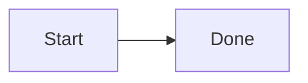

# Markdown Showcase

[TOC]

## Formatting

**Bold**, *italic*, ~~deleted~~, and `inline code`.

- [x] Completed task
- [ ] Pending task

| Item | Value |
| --- | --- |
| Fixture | Synthetic |

> A fixture is a reproducible starting point.

A footnote[^sample] and [Selection B](mweblib://10002).

[^sample]: This is the fixture footnote.

## Local image


## Code and optional runtimes

```swift
let message = "Hello, fixture"
```

Inline math: $a+b$.


