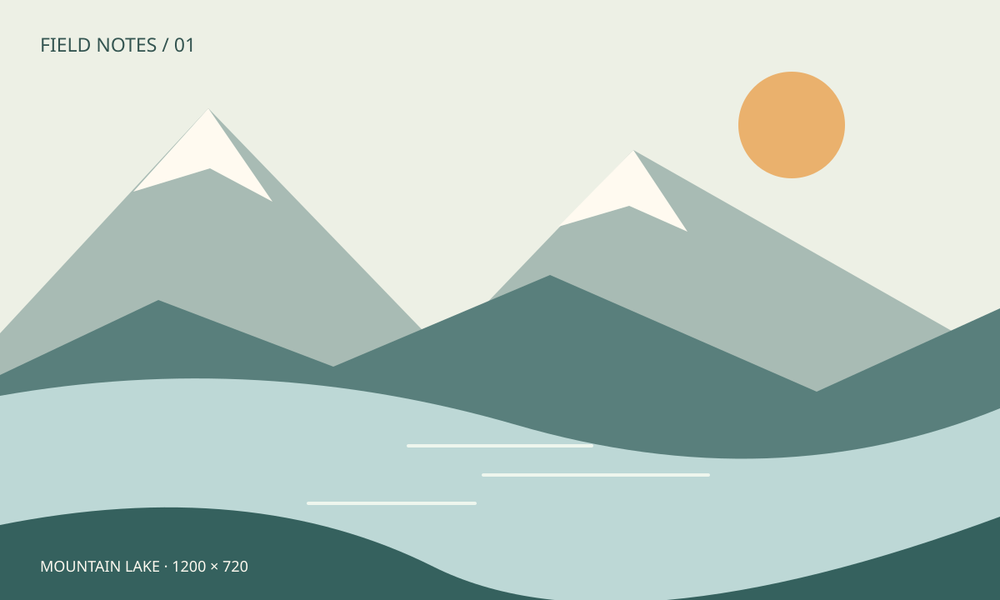
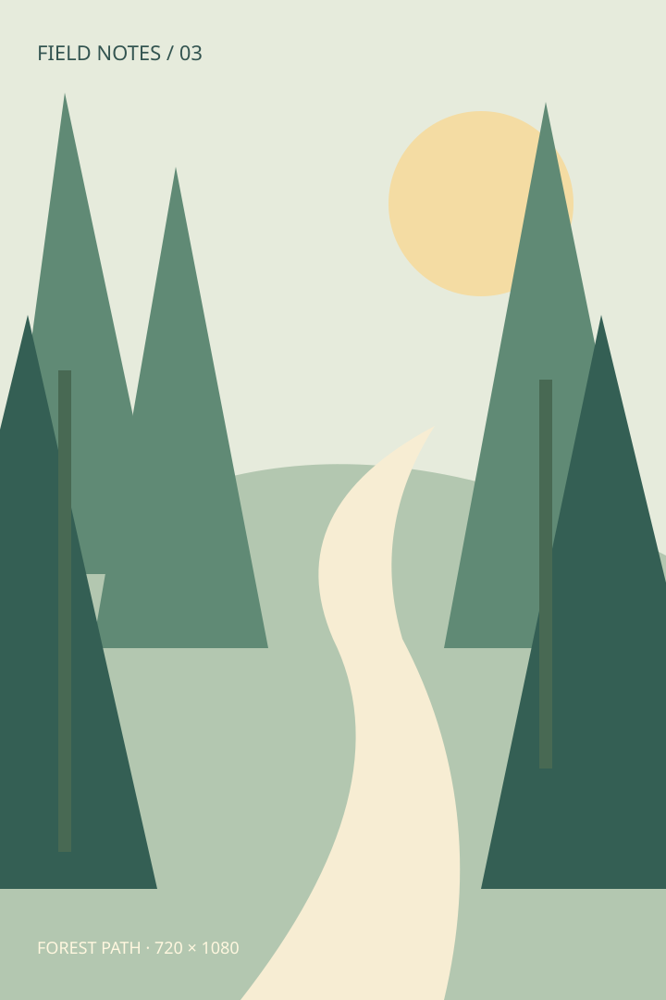
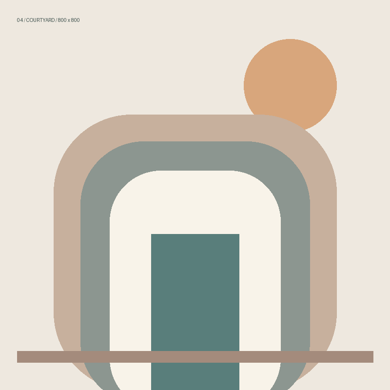

# 山间漫游 · 多图日记

一组虚构的旅行手记，用来观察长文章里图片与文字的节奏。这里的风景都是为演示制作的插画，图片保存在本地文库中。

## 清晨，先看见湖

山脊把天空分成几块，水面留下淡淡的倒影。宽图跟随正文区域缩放，下一段文字应该自然接在图片下面。

## 午后，穿过沙丘

全景图的高度更低，可以快速带过一段风景。连续滚动时，文字和图像都应完整显示。

## 傍晚，沿着林间小径

这张竖图使用 MWeb 的 `-w320` 标记限制显示宽度，画面比例保持不变。即使与横图交替出现，也不应该把正文撑出窗口。

## 回到院子

> 留一点空白，让每一张图都有被看见的时间。

旅程结束。下一篇「版式实验」会把同一组图片放在一起，方便比较尺寸和格式。
