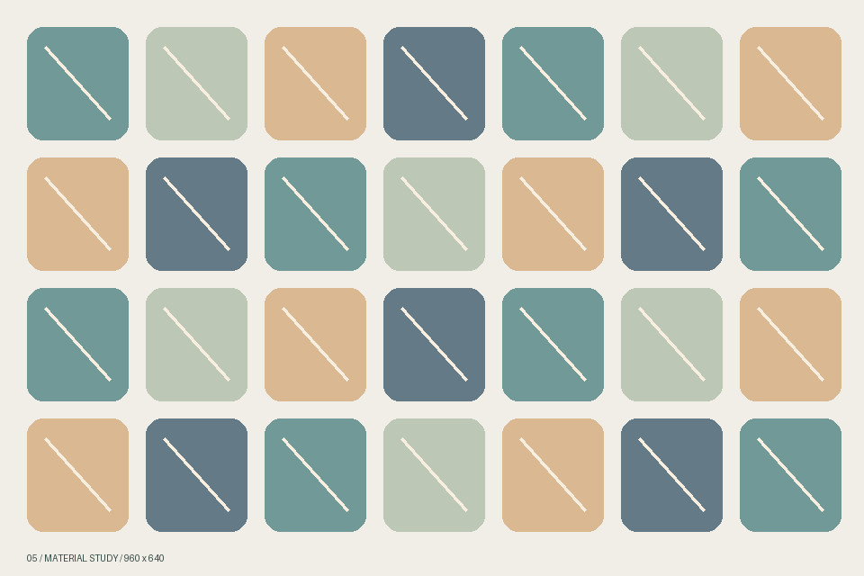

# 图文笔记 · 细节与留白

这是一篇混排笔记：段落、引用、列表和图片交替出现。所有图片都引用同一文库中的本地资源，不需要联网。

## 两张连续图片

两张图片之间保留正常段落间距。它们不会互相覆盖，后面的文字也不会压在图片上。

## 从颜色里找线索

观察时可以留意：

1. 背景色与主体色是否容易分辨。
2. 图片缩小之后，边缘是否完整。
3. 滚动到下一段时，文字是否仍然可读。

> 同样的颜色，在不同面积里会给人不同的感受。

## 一点透明的留白

小尺寸图片适合插在段落之间。透明区域应与正文背景自然融合。

## 最后再看一眼

- [x] 横图与全景
- [x] JPEG 与 PNG
- [x] 透明背景与指定宽度

**混排笔记结束。**
