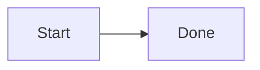

# Preview verification

[TOC]

## Formatting

**Bold** ~~Deleted~~

- [x] A task

| A | B |
| - | - |
| 1 | 2 |

A footnote[^a]. [Article](mweblib://123456789)

[^a]: Footnote content


Math ``x^2``, and $a+b$.

$$
x = \frac{1}{2}
$$

```swift
let value = 2
```



```echarts
option = {xAxis:{type:'category',data:['A','B']},yAxis:{},series:[{type:'bar',data:[1,2]}]};
```

<script>window.noteExecuted = true</script>

<a href="javascript:window.noteExecuted=true">bad</a>
<div style="background:url(file:///etc/passwd)">Styled</div>
